# Building Microservices and a CI/CD Pipeline with AWS

Hands-on AWS Academy project: splitting a monolithic Node.js web application into two containerized microservices, running them on **Amazon ECS with AWS Fargate** behind an **Application Load Balancer**, and delivering updates through an automated **CI/CD pipeline** with **AWS CodePipeline** and **AWS CodeDeploy** using **blue/green deployments**.

> **About this repository.** The work was carried out inside an AWS Academy lab environment (a sandbox AWS account). This repository is **documentation only**: it describes what I built, why each step was needed, and what I learned. It does **not** contain the application source code, Dockerfiles, task definitions, AppSpec files or pipeline configuration. This is a guided lab project, not professional production experience.

**Author:** Oumaima EL ANSARI, Software Engineering student at ENSIAS (Cloud and DevOps track)

## Table of contents

1. [Project objectives](#project-objectives)
2. [Scenario and requirements](#scenario-and-requirements)
3. [Architecture overview](#architecture-overview)
4. [Technologies and AWS services used](#technologies-and-aws-services-used)
5. [Implementation, phase by phase](#implementation-phase-by-phase)
6. [Microservices architecture](#microservices-architecture)
7. [Docker containerization and Amazon ECR](#docker-containerization-and-amazon-ecr)
8. [Amazon ECS with AWS Fargate](#amazon-ecs-with-aws-fargate)
9. [Application Load Balancer and target groups](#application-load-balancer-and-target-groups)
10. [CI/CD pipeline with AWS CodePipeline](#cicd-pipeline-with-aws-codepipeline)
11. [Blue/green deployment with AWS CodeDeploy](#bluegreen-deployment-with-aws-codedeploy)
12. [Security and networking considerations](#security-and-networking-considerations)
13. [Testing and results](#testing-and-results)
14. [Screenshots](#screenshots)
15. [Skills gained](#skills-gained)
16. [Lessons learned](#lessons-learned)
17. [Conclusion](#conclusion)

## Project objectives

By the end of the project I was able to:

- Understand how a Node.js web application is deployed and connected to a relational database.
- Create a cloud IDE (AWS Cloud9) and a Git repository (AWS CodeCommit) for the code.
- Split a monolithic application into separate containerized microservices.
- Store and version Docker images in a container registry (Amazon ECR).
- Run the containers on a serverless cluster (ECS with Fargate) for cost optimization and scalability.
- Route traffic between the microservices with an Application Load Balancer and multiple target groups.
- Build CI/CD pipelines that deploy new versions with a blue/green strategy.
- Iterate on the application through the pipeline, and scale one microservice independently.

## Scenario and requirements

A café corporation acquired a coffee supplier that ran a supplier-listing application as a **monolith** with reliability and performance issues. The goal was to split it into microservices so that each part can be scaled, updated and fail independently.

| ID | Requirement | How it is addressed |
|---|---|---|
| R1 | Design | Architecture diagram (phase 1) |
| R2 | Cost optimized | Cost estimate with the AWS Pricing Calculator (phase 1), serverless Fargate cluster |
| R3 | Microservices-based architecture | Customer and employee microservices (phases 3 to 5) |
| R4 | Portability | Docker images that do not depend on a specific host |
| R5 | Scalability / resilience | ECS services, load balancer routing, independent scaling (phases 6, 7, 9) |
| R6 | Automated CI/CD | CodePipeline and CodeDeploy pipelines (phases 8, 9) |

## Architecture overview

### Why design the architecture before implementation?

1. Understand the complete solution
2. Plan the implementation
3. Identify risks early
4. Estimate costs and resources
5. Communicate with the team

The lab asks for these elements in the diagram: Amazon VPC; EC2 instances, Application Load Balancer and target groups; CodeCommit repository; CodeDeploy; CodePipeline; ECS services, containers and tasks; ECR repository; Cloud9 environment; IAM roles; Amazon RDS; and CloudWatch Logs.

### Why I have to develop a cost estimate

[Building-Microservices-and-a-CI-CD-Pipeline-with-AWS_cost_estimate.pdf](https://github.com/user-attachments/files/34703740/Building-Microservices-and-a-CI-CD-Pipeline-with-AWS_cost_estimate.pdf)

Imagine that before deploying it, your manager might ask:

- How much will this architecture cost per month?
- Which AWS services will generate expenses?
- What happens if the number of users increases?
- Can we reduce the cost without sacrificing performance?
- Is this architecture financially reasonable for the project?

**How would you do this in a real company?**

1. **Understand the architecture.** Identify all services, resources, and dependencies.
2. **Define assumptions.** Estimate the number of users, requests, running hours, CPU, memory, and storage requirements.
3. **Identify pricing models.** Check whether each service is charged per hour, per GB, per request, or by another unit.
4. **Use a cost estimation tool.** For AWS, use the AWS Pricing Calculator to estimate the monthly cost (the lab asks for Region us-east-1 over 12 months).
5. **Analyze and optimize.** Compare different configurations and identify possible savings.
6. **Present the results.** Prepare a cost breakdown, assumptions, estimated monthly total, and recommendations.

### Request flow

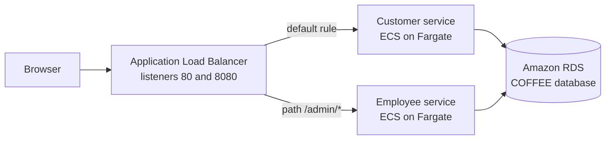

### Delivery flow

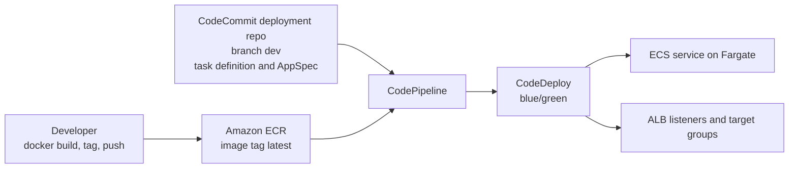

### Regional resources versus Availability Zone resources

| Scope | Resources in this project |
|---|---|
| Regional | VPC, Application Load Balancer (nodes placed in the Availability Zones of the chosen subnets), target groups (scoped to the VPC), ECS cluster and services, ECR, CodeCommit, CodePipeline, CodeDeploy, CloudWatch Logs |
| Global | IAM roles |
| Availability Zone level | Subnets, EC2 instances (monolith server, Cloud9 instance), Fargate tasks (placed in the zone of their subnet), the RDS database instance (single zone unless Multi-AZ is enabled; the lab does not examine this) |

Using two public subnets in different zones for the load balancer and the ECS tasks is what gives the design its zone-level resilience.

## Technologies and AWS services used

| Service / technology | Purpose | Role in this project |
|---|---|---|
| Amazon VPC (LabVPC) | Networking | Isolated network with public and private subnets |
| Amazon EC2 | Compute | Runs the original monolith and the Cloud9 instance |
| AWS Cloud9 | Cloud IDE | Editing, Docker builds, Git and AWS CLI |
| AWS CodeCommit | Git hosting | `microservices` repository (source code) and `deployment` repository (task definitions, AppSpec files) |
| Docker | Containerization | Packages each microservice |
| Amazon ECR | Container registry | Stores the `customer` and `employee` images |
| Amazon ECS | Container orchestration | Cluster, task definitions and services |
| AWS Fargate | Serverless compute | Runs containers without managing servers |
| Application Load Balancer | Layer 7 routing | Listeners, path-based rules, health checks |
| AWS CodePipeline | CI/CD orchestration | Two pipelines, one per microservice |
| AWS CodeDeploy | Deployment automation | Blue/green deployments on ECS |
| Amazon RDS | Managed database | Stores the supplier data (database `COFFEE`) |
| Amazon CloudWatch | Logs | Container logs (log group `awslogs-capstone`) |
| AWS IAM | Access management | Roles used by the pipeline and CodeDeploy |
| Git, Bash, AWS CLI, Node.js / Express.js | Tooling and runtime | Version control, scripting, application framework |

## Implementation, phase by phase

### Phase 1: Planning the design and estimating cost

Created the architecture diagram and the cost estimate described above. Planning first made the dependencies between services visible before any resource was created.

### Phase 2: Analyzing the monolithic application

- Verified that the monolith was reachable on the public IP of the `MonolithicAppServer` EC2 instance, and tested it (list, add and edit suppliers), noting the URL paths `/suppliers`, `/supplier-add` and `/supplier-update/1`. These paths matter because they later drive the routing between microservices.
- Connected to the instance and inspected how it runs: `sudo lsof -i :80` shows which process listens on port 80, and `ps -ef | grep node` shows which user runs the Node.js process and its process ID, so the two outputs can be compared.
- Connected a MySQL client to the RDS database and observed the `suppliers` table in the `COFFEE` database.

Takeaway: the application is a single Node.js process serving every route on port 80, directly on the host, backed by one database. One unit to deploy, one unit to scale.

### Phase 3: Development environment and Git repository

- Created a Cloud9 environment (`MicroservicesIDE`) in the LabVPC, in a public subnet.
- Copied the monolith source code from the application server to the IDE with `scp`, authenticating with the lab-provided SSH key (the key itself is never published).
- Created two working directories, `customer` and `employee`, each holding a copy of the code.
- Initialized a Git repository on branch `dev` and pushed it to a CodeCommit repository named `microservices`.

### Phase 4: Two microservices tested in Docker containers

- **Customer** (read-only): removed the add, edit and delete logic from the controller and model, removed the matching views and buttons, added an "Administrator link" to the navigation, and set the application port to 8080.
- **Employee** (read-write): prefixed the routes, form actions and links with `/admin`, changed titles to "Manage coffee suppliers", and kept a link back to the customer area.
- Wrote a Dockerfile for each service (Node.js Alpine base image, `npm install`, exposed port, start command), built the images with `docker build`, and ran test containers on the Cloud9 instance, passing the database endpoint as the environment variable `APP_DB_HOST`.
- The employee service was first tested on port 8081 (so both containers could run side by side on one host), then switched to 8080 for ECS and rebuilt.
- Opened ports 8080 and 8081 in the Cloud9 instance's security group for testing, and pushed the changes to CodeCommit.

### Phase 5: ECR, ECS cluster, task definitions and AppSpec files

- Created two private ECR repositories (`customer`, `employee`), tagged the images with the registry address and pushed them.
- Created a Fargate cluster named `microservices-serverlesscluster` in the LabVPC public subnets.
- Created a second CodeCommit repository, `deployment`, for the deployment files.
- Wrote and registered a **task definition** per microservice (Fargate, `awsvpc` network mode, CPU and memory sizes, port mapping 8080, CloudWatch log configuration) and an **AppSpec** file per microservice for CodeDeploy.
- Replaced the image value in the task definitions with the placeholder `IMAGE1_NAME` before pushing them. The pipeline later substitutes the real image reference at runtime (see [CI/CD pipeline](#cicd-pipeline-with-aws-codepipeline)).

### Phase 6: Target groups and Application Load Balancer

- Created four target groups (`customer-tg-one`, `customer-tg-two`, `employee-tg-one`, `employee-tg-two`): type IP, HTTP, port 8080, in LabVPC, with health check path `/` for customer and `/admin/suppliers` for employee.
- Created the security group `microservices-sg` (inbound TCP 80 and 8080) and the internet-facing load balancer `microservicesLB` across two public subnets.
- Listener **HTTP:80** forwards to `customer-tg-two` by default, with a rule sending `/admin/*` to `employee-tg-two`. Listener **HTTP:8080** forwards to `customer-tg-one` by default, with a rule sending `/admin/*` to `employee-tg-one`.

### Phase 7: ECS services

Created one ECS service per microservice from JSON definitions with the AWS CLI: Fargate launch type, desired count 1, the registered task definition revision, the matching `*-tg-two` target group, public subnets, the `microservices-sg` security group, and `CODE_DEPLOY` as the deployment controller. Both services were active with 0 running tasks, which is expected until CodeDeploy launches the first task set.

### Phase 8: CodeDeploy and CodePipeline

- Created the CodeDeploy application `microservices` (ECS platform) with two deployment groups (`microservices-customer`, `microservices-employee`): production listener 80, test listener 8080, target group 1 set to the `two` group and target group 2 to the `one` group, traffic rerouted immediately, original task set terminated after 5 minutes.
- Created the pipelines `update-customer-microservice` and `update-employee-microservice`: CodeCommit source (`deployment`, branch `dev`), no build stage, deploy action "Amazon ECS (Blue/Green)". Added a second source action using the **Amazon ECR** provider (repository, tag `latest`) and configured the deploy action to replace `IMAGE1_NAME` with the image from that source.
- Released both pipelines manually, followed the deployments in CodeDeploy, tested the application through the load balancer, and observed how CodeDeploy rewrote the load balancer rules.

### Phase 9: Restricting, updating and scaling

- Reassociated the target groups with the load balancer, then added a **source IP** condition (my public IP with a /32 mask) to the `/admin/*` rule on both listeners.
- Changed the employee navigation bar style, rebuilt the image and pushed it to ECR. The push triggered the employee pipeline automatically.
- Verified that a request to `/admin/suppliers` from a different source IP (the Cloud9 instance, using `curl`) received a 404 page.
- Scaled the customer service from 1 to 3 tasks with `aws ecs update-service --desired-count 3`, without triggering any pipeline.

## Microservices architecture

| Microservice | Audience | Access | Routes |
|---|---|---|---|
| Customer | Café franchise managers | Read-only | `/` and `/suppliers` |
| Employee | Corporate office staff | Read-write | `/admin/...` |

Splitting by audience lets each service be developed, released, scaled and secured separately. If one becomes unavailable, the other can keep running. In this lab both services still share one RDS database, which keeps things simple but couples them at the data layer.

## Docker containerization and Amazon ECR

- A **Docker image** is a template (base image, dependencies, application code, start command). A **container** is a running instance of an image. The same image runs unchanged in Cloud9 and on Fargate, which satisfies the portability requirement (R4).
- Configuration comes from outside the image: the database location is passed as the environment variable `APP_DB_HOST`.
- **Amazon ECR** is the private registry where the images are stored under the repositories `customer` and `employee`. Images are tagged with the registry address before being pushed.

Ports, to avoid confusion:

| Concept | Meaning | Value in this project |
|---|---|---|
| Container port | Port the application listens on inside the container | 8080 |
| Host port | Port published on the host (`-p host:container`) | 8080 for customer; 8081 for the employee test container; on Fargate the host port equals the container port |
| Listener port | Port the load balancer accepts traffic on | 80 (production) and 8080 (test) |
| Security group rule | Which traffic may reach a resource | `microservices-sg` allows TCP 80 and 8080; the Cloud9 security group allowed 8080 and 8081 for tests |

## Amazon ECS with AWS Fargate

- **Cluster**: logical grouping of capacity (`microservices-serverlesscluster`, Fargate only, so no servers to manage).
- **Task definition**: the blueprint of a container (image, CPU and memory, ports, network mode, log configuration). It is versioned: each registration creates a new revision.
- **Task**: a running instance of a task definition.
- **Service**: keeps the desired number of tasks running and registers them with the load balancer.

Fargate tasks use the `awsvpc` network mode: each task gets its own network interface and IP address, which is why the target groups use the **IP** target type. The services use `CODE_DEPLOY` as deployment controller, so ECS keeps tasks alive while CodeDeploy handles releases.

## Application Load Balancer and target groups

The load balancer provides one public entry point for both services.

- **Listeners** accept traffic on a port (80 and 8080).
- **Rules** decide where a request goes. The rule "path is `/admin/*`" sends requests to the employee target group, and everything else falls to the default rule (customer).
- **Target groups** contain the running tasks and run **health checks** (`/` for customer, `/admin/suppliers` for employee). Targets that fail the check do not receive traffic.

Each microservice has **two target groups** because blue/green deployment needs a current environment and a replacement environment at the same time. Listener 80 is the production listener and listener 8080 is the test listener for the replacement version.

## CI/CD pipeline with AWS CodePipeline

Each microservice has its own pipeline with two stages:

1. **Source**: two actions. CodeCommit provides the task definition template and the AppSpec file (repository `deployment`, branch `dev`). Amazon ECR provides the image details (repository, tag `latest`). A new image pushed to ECR triggers the pipeline.
2. **Deploy**: "Amazon ECS (Blue/Green)", using CodeDeploy.

**How `IMAGE1_NAME` works.** The task definition stored in CodeCommit contains the placeholder `IMAGE1_NAME` instead of an image name. The deploy action is configured with the ECR source as "input artifact with image details" and `IMAGE1_NAME` as the placeholder text. At runtime the pipeline replaces the placeholder with the real image reference, registers a new task definition revision, and hands it to CodeDeploy.

There is no build stage in this lab: building the image and pushing it to ECR is a manual step done from the Cloud9 terminal.

## Blue/green deployment with AWS CodeDeploy

Blue is the version currently serving production; green is the new version. Both exist at the same time as two task sets behind two target groups.

1. CodeDeploy starts a **replacement task set** on the idle target group.
2. The replacement version is reachable on the **test listener** (port 8080) so it can be checked.
3. CodeDeploy **reroutes the production listener** (port 80) to the replacement target group (configuration `ECSAllAtOnce`, reroute immediately).
4. It waits for a **5-minute** window, during which the deployment can be stopped and rolled back from the console.
5. It **terminates the original task set**.

After a deployment the roles of the two target groups are swapped: the default rule of the production listener points to the former green group, and the former blue group may show as no longer associated with the load balancer. This is normal. Because CodeDeploy rewrites the listener rules, the lab asks to check that all four target groups are associated before every pipeline run.

Why it reduces risk: the old version keeps serving users until the new one is running, the new version can be tested before it receives production traffic, and rollback during the waiting window is a traffic switch rather than a rebuild. The cost is temporary duplicate capacity and more load balancer objects.

## Security and networking considerations

What the lab implements:

- A security group on the load balancer, IAM roles for the pipeline and CodeDeploy, and a **source IP restriction** on the employee path at the load balancer.
- Separation of read and write functionality into two services, so the customer image contains no write routes.

Limits I identified (lab trade-offs, not production practice):

- Listeners are **HTTP only**; production would need HTTPS with a certificate.
- The restriction by source IP identifies a network origin, not a user: it is not authentication and breaks when the IP changes.
- ECS tasks run in public subnets with public IPs, and the same security group opens ports 80 and 8080 to the internet, so the load balancer rule might not be the only way to reach a task directly (not tested).
- The ECR repository policy used in the lab is very permissive (all principals, all ECR actions).
- The database endpoint is stored in plain text in the task definition environment.

Improvements I would make: private subnets with a security group that only accepts traffic from the load balancer, HTTPS, a secrets manager for credentials, least-privilege policies, real authentication for the admin service, and image scanning.

## Testing and results

| Check | Result |
|---|---|
| Employee microservice through the load balancer at `/admin/suppliers` | Page loaded with the supplier list and administration controls |
| First run of the customer pipeline | Source succeeded; Deploy failed as announced by the lab, before the ECR source and `IMAGE1_NAME` substitution were configured |
| Customer deployment | Succeeded; the default rule of listener 80 then pointed to `customer-tg-one` and `customer-tg-two` showed as not associated |
| Employee image rebuilt and pushed to ECR | New image ID, layers pushed; the employee pipeline started automatically |
| `curl` to `/admin/suppliers` from Cloud9 (different source IP) | 404 page titled "Coffee suppliers", confirming the IP restriction |
| Customer service scaled to 3 tasks | 3/3 tasks running; employee service 1/1; both deployments Succeeded |
| Target group health | `customer-tg-one` reported 3 healthy targets across two Availability Zones; `employee-microservice` reported 1 healthy target |
| CodeDeploy deployment | All five steps and all lifecycle events Succeeded; 100% of the traffic on the replacement task set |

## Screenshots

All captures come from my AWS Academy lab session. Account identifiers, public addresses, the database endpoint and repository URIs were hidden before publishing.

### Development environment

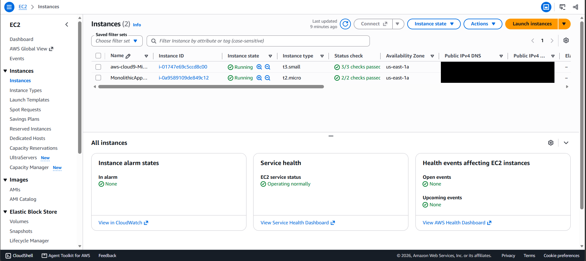

The two EC2 instances used in the lab, both running in `us-east-1a`: the Cloud9 instance (`t3.small`) and the `MonolithicAppServer` (`t2.micro`) that hosts the original monolith. Public addresses are hidden.

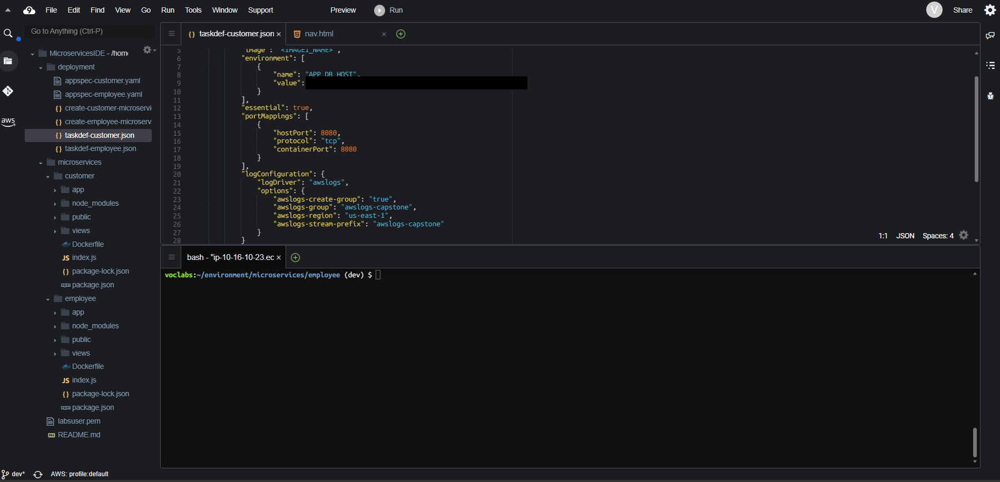

The Cloud9 environment `MicroservicesIDE`. The `deployment` folder holds the AppSpec files, the task definition files and the ECS service JSON files; the `microservices` folder holds the `customer` and `employee` services with their Dockerfiles. The open task definition shows the `IMAGE1_NAME` image placeholder, the port mapping on 8080 and the CloudWatch log configuration (log group `awslogs-capstone`). The database endpoint is hidden.

### Container registry

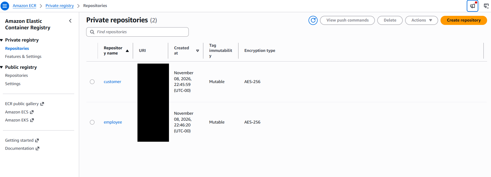

The two private ECR repositories, `customer` and `employee` (tag immutability off, AES-256 encryption). Repository URIs are hidden.

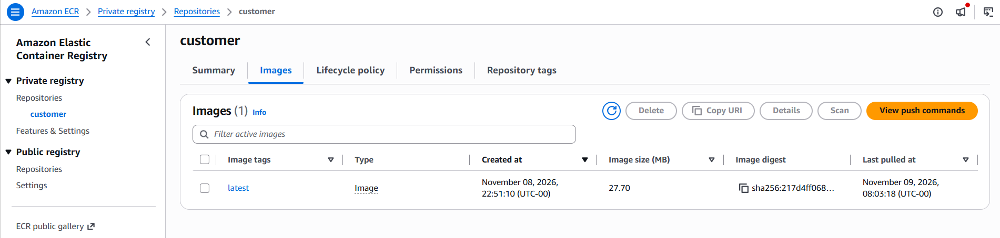

The `customer` repository holds one image tagged `latest`. Its digest starts with `sha256:217d4ff068`, the same digest shown by the customer pipeline below.

### Load balancer and target groups

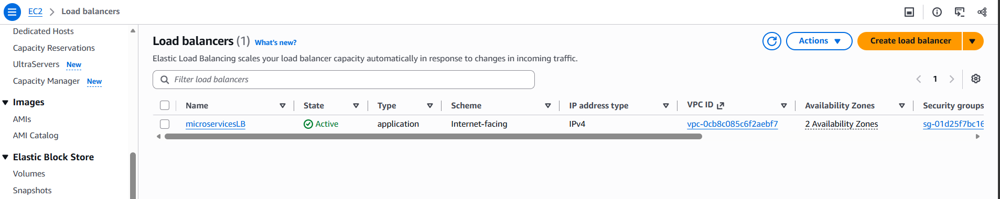

`microservicesLB`: application load balancer, internet-facing, IPv4, state Active, spanning two Availability Zones.

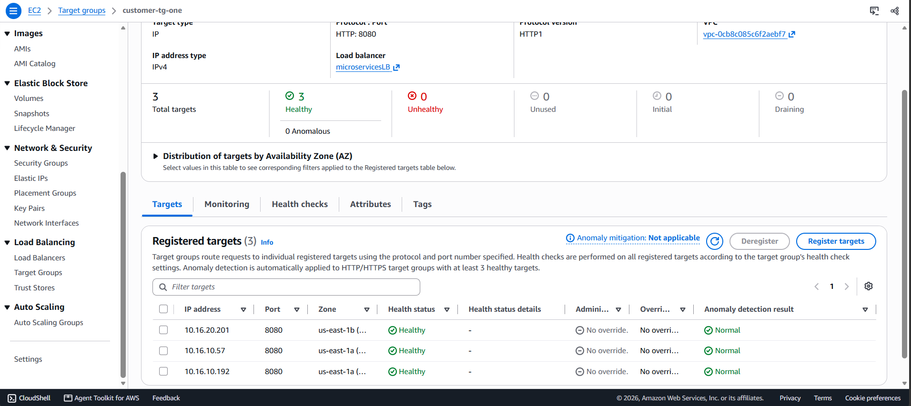

The target group `customer-tg-one` (type IP, HTTP on port 8080) attached to `microservicesLB`: 3 registered targets, all healthy, spread over two Availability Zones (`us-east-1a` and `us-east-1b`).

### ECS on Fargate

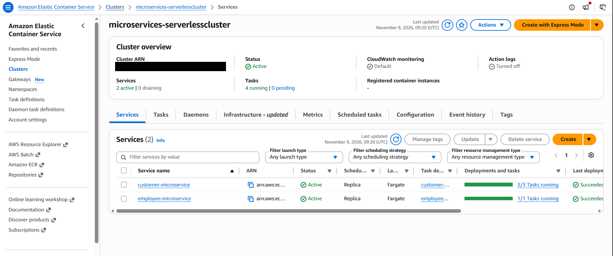

The cluster `microservices-serverlesscluster` with two active Fargate services: `customer-microservice` at 3/3 tasks running and `employee-microservice` at 1/1, both with last deployment Succeeded. This is the result of scaling the customer service independently. The cluster ARN is hidden.

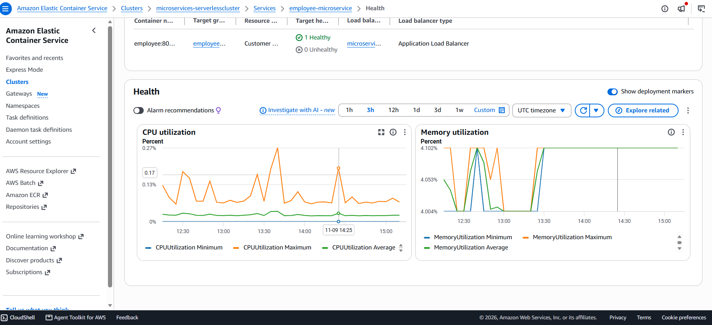

The health view of `employee-microservice`: the load balancer target group reports 1 healthy and 0 unhealthy targets, alongside CPU and memory utilization charts.

### CI/CD pipelines

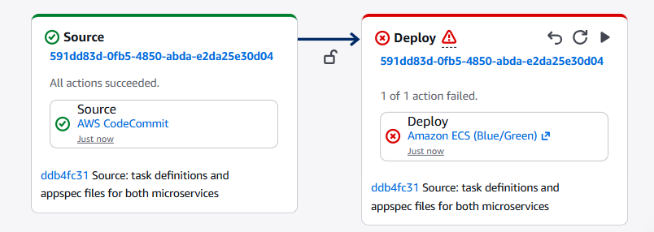

The first execution of `update-customer-microservice`: the source stage succeeded and the deploy stage failed as expected, because the Amazon ECR source action and the `IMAGE1_NAME` image substitution had not yet been configured.

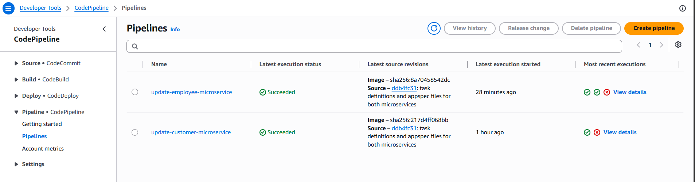

Both pipelines with a latest execution of Succeeded. The source revisions show the ECR image digest and the CodeCommit commit of the deployment files. The older failed runs in the execution history correspond to the initial runs before the configuration was complete.

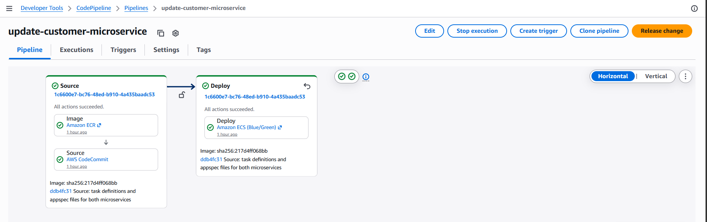

`update-customer-microservice`: the Source stage has two actions (Image from Amazon ECR, Source from AWS CodeCommit) and the Deploy stage uses Amazon ECS (Blue/Green). All actions succeeded.

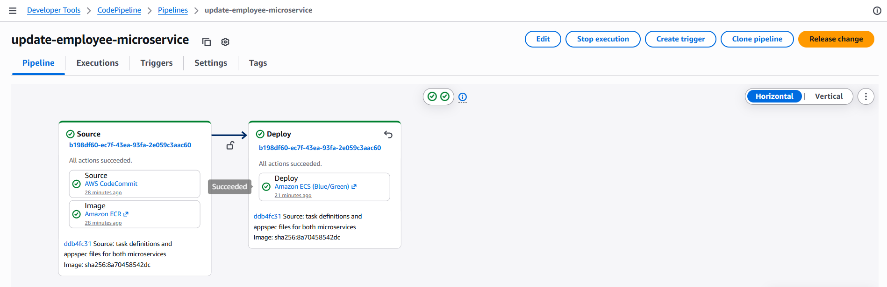

`update-employee-microservice`: same structure, all actions succeeded. The image digest shown (`sha256:8a70458542dc`) matches the digest returned when I pushed the updated employee image to ECR.

### Blue/green deployment with CodeDeploy

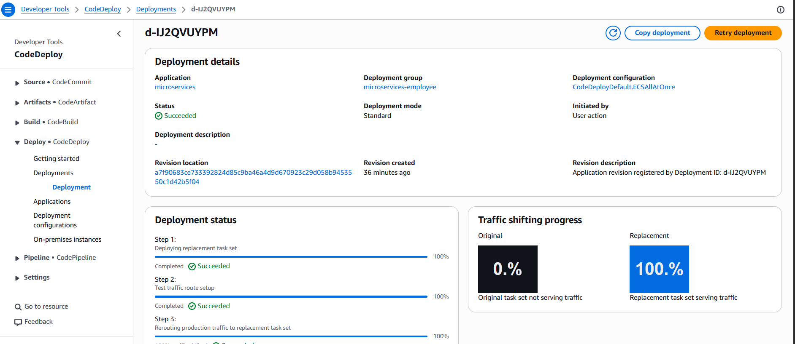

A deployment of the application `microservices` to the deployment group `microservices-employee`, using `CodeDeployDefault.ECSAllAtOnce`. The status is Succeeded and the traffic shifting panel shows 0% on the original task set and 100% on the replacement.

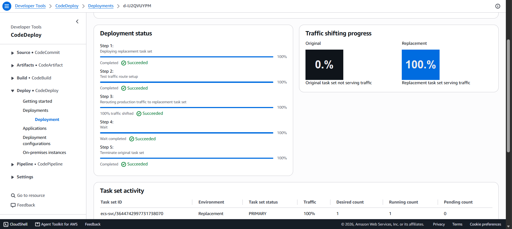

The five deployment steps all succeeded: deploy the replacement task set, set up the test traffic route, reroute production traffic, wait, and terminate the original task set.

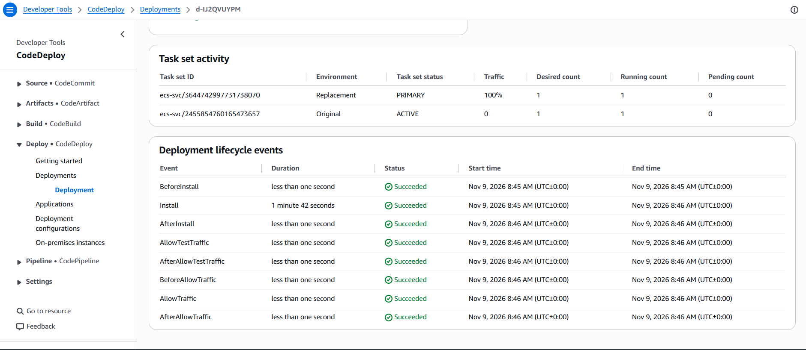

The task set activity (the replacement task set is PRIMARY and receives 100% of the traffic) and the lifecycle events from `BeforeInstall` to `AfterAllowTraffic`, all Succeeded. The `Install` event, which starts the replacement tasks, took 1 minute 42 seconds.

### Application interface

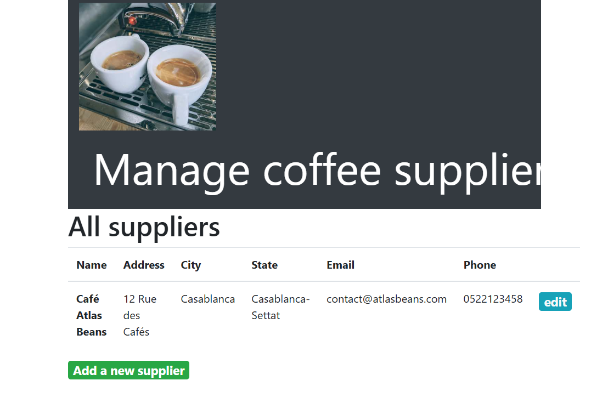

The employee microservice served at the `/admin/suppliers` path through the Application Load Balancer. It lists the suppliers and offers the edit and "Add a new supplier" controls, which the customer service does not have.

## Skills gained

- Decomposing a monolith into services and defining boundaries by audience.
- Building, tagging and pushing Docker images; running containers with environment-based configuration.
- Running containers on ECS with Fargate (clusters, task definitions, services, scaling).
- Configuring an Application Load Balancer with listeners, path-based rules, target groups and health checks.
- Building CI/CD pipelines with CodePipeline and blue/green deployments with CodeDeploy.
- Using the AWS CLI and Git from a cloud IDE; troubleshooting permission and configuration errors.
- Reasoning about security, cost and scalability trade-offs.

## Lessons learned

- **Check the real state before acting.** After a blue/green deployment, CodeDeploy swaps the target groups and rewrites the listener rules, so the load balancer must be verified before each pipeline run.
- **Read the exact error message.** A pipeline save failed with a "minimum number of input artifacts" message because I had picked a build-and-push ECR action instead of the Amazon ECR source provider. A rule creation was denied with an `AddTags` permission error because the lab role is restricted: the rule did not exist after the error, so I had to retry.
- **Rebuild after every change.** An image can look current while still containing old code. Checking the image creation time before pushing avoids deploying an unchanged image.
- **Similar ports are not the same thing.** The container port, the listener ports and the security group ports are separate settings.
- **Documentation can be wrong.** The lab states that the employee page should have no edit or add buttons, but the employee microservice is the administrative interface and does show them.
- **Automation has gaps.** Deployment is automated, but the image build is still manual. Automating it with a build service is the natural next step.

## Conclusion

This project took a monolithic application to two independently deployable microservices running on Fargate behind a path-routing load balancer, with automated blue/green delivery triggered by an image push. I changed and redeployed the employee service without touching the customer service, restricted access to the admin path at the load balancer, and scaled the customer service on its own.

The main limits are those of a lab environment: manual image builds, HTTP only, public subnets and a shared database. Next steps would be an automated build stage with commit-based image tags, infrastructure as code, secrets management, HTTPS with private subnets, auto scaling and monitoring alarms.

Source of the exercise: the AWS Academy lab guide *Building Microservices and a CI/CD Pipeline with AWS*.

## AWS Academy Certificate

[AWS_Academy_Graduate___Microservices_and_CI_CD_Pipeline_Builder___Training_Badge_Badge20261109-20-a6ir6j.pdf](https://github.com/user-attachments/files/34738259/AWS_Academy_Graduate___Microservices_and_CI_CD_Pipeline_Builder___Training_Badge_Badge20261109-20-a6ir6j.pdf)
